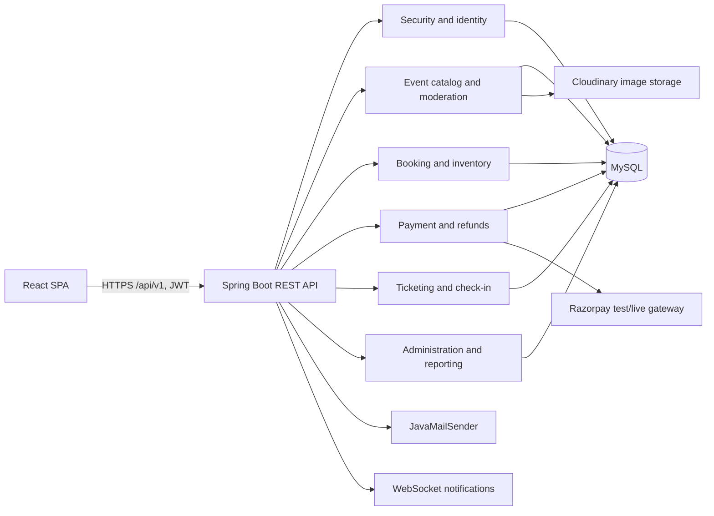
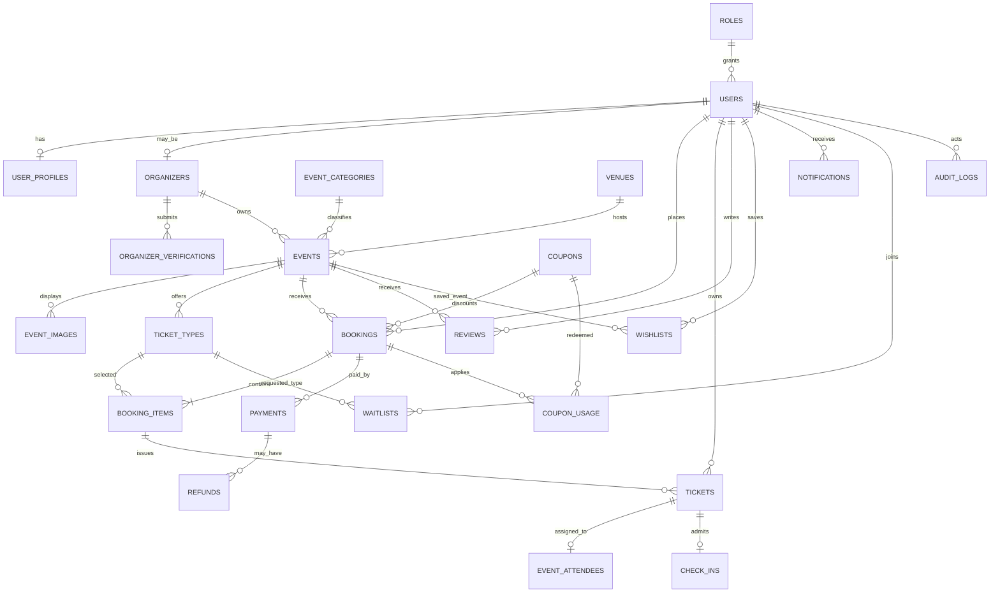

# VENTIXE — Phase 1: Requirements, Architecture, and Data Design

## Scope

Phase 1 establishes the system boundaries, core workflows, relational model, ER diagram, and intended repository layout. It does not implement the React application, Spring Boot services, integrations, or deployment. The schema in `database/schema.sql` targets MySQL 8.0.16+ and includes reference seed data for roles and event categories only; it creates no default user or credentials.

## Requirements summary

VENTIXE has three account roles: customer, organizer, and administrator. Customers discover events, reserve ticket inventory, pay, receive and manage tickets, and use related features such as wishlists, reviews, and waitlists. Organizers manage their own events and attendees, while administrators moderate organizers and events and oversee platform operations.

The key system qualities are:

- Authorization enforced by the backend on every protected operation; frontend route guards are for navigation, not security.
- Booking and inventory changes are transactional and safe under concurrent requests.
- Payment state is confirmed only after server-side gateway verification or a verified webhook; processing is idempotent.
- Ticket QR values are unguessable opaque tokens, not embedded personal or payment data. A successful check-in consumes the ticket exactly once.
- Secrets and provider credentials are supplied through environment-specific configuration, never committed to source control.
- Monetary values use fixed-precision decimal columns and an explicit ISO currency code.
- Event, booking, payment, and audit history is retained; operational entities use status transitions rather than destructive deletion.

## Proposed architecture

Use a modular monolith for the first release. It keeps booking/payment transactions straightforward while preserving clear module boundaries for future scaling.



### Backend module boundaries

Each module follows the same Controller → Service → Repository → Entity pattern, with DTOs at API boundaries:

- **identity** — registration, login, profile, organizer verification, roles, JWT.
- **events** — categories, venues, event discovery, event lifecycle, images, approvals.
- **booking** — reservation, pricing snapshot, coupon application, inventory, cancellation.
- **payments** — gateway order creation, signature/webhook verification, payment history, refunds.
- **tickets** — ticket issuance, PDF delivery, QR validation, check-in.
- **engagement** — wishlist, reviews, waitlists, notifications, reminders.
- **analytics** — scoped organizer reports and platform administrator reports.
- **admin** — account controls, moderation, audit trail, coupon administration.

Controllers validate and translate HTTP requests; business rules and transaction boundaries live in services. Repositories use Spring Data JPA and parameterized queries. DTO validation and a global error handler provide consistent client-facing errors.

### Frontend boundaries

The React SPA uses React Router, Axios, Context API for session-level state, React Hook Form for forms, and Recharts for analytics. Organize screens by public, customer, organizer, and administrator areas. A shared API client attaches credentials and handles common errors; protected routes provide UX gating while the API remains authoritative for access checks.

### Critical workflows and invariants

1. **Event publication:** organizer submits a draft → administrator approves (where required) → event becomes discoverable. Organizers may only mutate events they own.
2. **Booking:** validate event/ticket sales window and quantity → lock relevant ticket inventory rows in a database transaction → reserve inventory with an expiry → calculate and persist a price snapshot → create a pending booking. Expired reservations release inventory.
3. **Payment:** create a gateway order for the persisted amount → verify payment signature/webhook server-side → process each gateway event idempotently → mark booking paid and issue one unique ticket per purchased admission. A browser redirect alone is not proof of payment.
4. **Cancellation/refund:** validate policy and booking ownership → transition booking/tickets → restore inventory only when policy permits → create a refund request/record and process its state separately.
5. **Check-in:** authenticate an authorized organizer/staff member → resolve the opaque QR token → atomically change a valid ticket to used and create one check-in record. Repeated scans return an already-used result without creating another check-in.
6. **Isolation:** customer endpoints scope records to the authenticated user; organizer endpoints scope events and attendee data to the organizer; administrator endpoints require the administrator role.

## Data model notes

- `users` is the identity record; `user_profiles` and `organizers` hold role-specific details.
- `events` references one organizer, category, and venue. `event_images` and `ticket_types` are child records.
- `bookings` represents a customer's order for one event. `booking_items` stores ticket-type quantities and price snapshots.
- `payments` records gateway attempts independently of the booking; `refunds` records refund requests and outcomes.
- `tickets` represents individual admissions, enabling unique QR validation and check-in.
- `event_attendees` contains attendee/contact data associated with a purchased ticket. `check_ins` is a separate immutable entry record.
- `coupon_usage` and `reviews` enforce one use per booking and one review per user/event, respectively.
- `organizer_verifications`, `notifications`, `waitlists`, and `audit_logs` support moderation and platform operations.
- Status values are constrained in the schema. Cross-row business rules (availability, coupon limits, ownership, allowed transitions) are enforced transactionally in services.

## ER diagram



## Proposed repository layout

```text
ventixe/
├── frontend/
│   ├── public/
│   └── src/
│       ├── app/                 # router and application providers
│       ├── api/                 # Axios client and endpoint modules
│       ├── components/          # shared UI and form components
│       ├── features/
│       │   ├── auth/
│       │   ├── events/
│       │   ├── bookings/
│       │   ├── tickets/
│       │   ├── organizer/
│       │   └── admin/
│       ├── hooks/
│       ├── layouts/
│       ├── pages/
│       ├── context/
│       ├── utils/
│       └── styles/
│   └── .env.example
├── backend/
│   ├── pom.xml
│   ├── .env.example
│   └── src/
│       ├── main/
│       │   ├── java/com/ventixe/
│       │   │   ├── config/
│       │   │   ├── security/
│       │   │   ├── common/       # validation, errors, shared utilities
│       │   │   ├── identity/
│       │   │   ├── events/
│       │   │   ├── booking/
│       │   │   ├── payments/
│       │   │   ├── tickets/
│       │   │   ├── engagement/
│       │   │   ├── analytics/
│       │   │   └── admin/
│       │   └── resources/
│       │       ├── application.yml
│       │       └── db/migration/
│       └── test/java/com/ventixe/
├── database/
│   └── schema.sql
├── docs/
│   └── PHASE-1-ARCHITECTURE.md
└── README.md
```

When implementation begins, database changes should be maintained as ordered migrations (for example, Flyway) rather than editing a deployed schema manually. The standalone schema is the Phase 1 baseline and local bootstrap reference.

## Phase 1 acceptance checklist

- [x] Architecture and module responsibilities documented.
- [x] Main workflows and security/inventory invariants documented.
- [x] Relational entities, key relationships, and ER diagram documented.
- [x] Frontend/backend folder structure proposed.
- [x] MySQL DDL and reference seed data provided in `database/schema.sql`.
- [x] Phase 2 implementation began after user confirmation; its frontend preview is under `frontend/`.
- [x] Phase 3 backend foundation and public catalog endpoints are under `backend/`.
- [x] Phase 4 JWT authentication, account registration, and server-side role checks are under `backend/`; React auth flows are under `frontend/`.
- [x] Phase 5 event discovery/detail pages and organizer event draft, edit, submit, and archive workflows are under `frontend/` and `backend/`.

## Phase 3 implementation

The Spring Boot API foundation, MySQL/JPA configuration, core catalog entities and repositories, OpenAPI documentation, shared error responses, and public read APIs are in `backend/`. Organizer event write workflows were implemented in Phase 5.

## Phase 4 implementation

Registration and login issue short-lived JWTs in HttpOnly cookies; unsafe requests require a CSRF cookie/header pair. Public registration is limited to customer and organizer roles; organizer verification remains pending until administrator review. Role-scoped API routes are enforced in Spring Security, and the React sign-in/register forms and dashboard route guards use the authenticated server account. Email verification and password recovery remain deferred to the notification/integration phase.

## Phase 5 implementation

Public event browsing supports keyword, city, category, date, and sort filters, pagination, and published event details. Organizers can create drafts with venue and ticket definitions, edit drafts or rejected events, submit for review, and archive eligible events. Organizer endpoints enforce authenticated ownership, suspended organizers cannot mutate events, and ticket inventory changes are blocked after reservations or sales. Event image upload and administrator approval remain deferred; no database schema changes were required.
